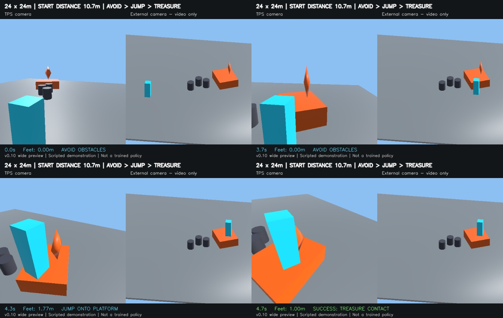

# atomic-task — 視覚からの原子スキル学習と複合タスクへの転移

Unityの画像観測から `look`・`approach`・`jump` をPPOで学習し、共有表現を複合タスクへ移したときの効果を比較する実験です。現在の版は **v0.10**。複合課題には、動画確認後に承認された **24m四方・開始位置4m後退版**を使います。

## 実験結果を読む

1. **[EXPERIMENT_REPORT.md](EXPERIMENT_REPORT.md)** — 条件、原子の最終結果、複合の途中経過、指標の定義。
2. **[CHATGPT_CONTEXT.md](CHATGPT_CONTEXT.md)** — ChatGPTに読ませる際の案内と解釈上の区別。
3. **[最新スナップショット](results/LATEST.json)** — 取得時刻と機械可読データへの入口。
4. **[PROTOCOL.md](PROTOCOL.md)** / [実験契約](configs/gaze_v10_contract.json) / [広域版の変更表](configs/gaze_v10_wide24_change.json)。

このリポジトリの結果は、明記した時点のスナップショットです。原子3seedは2000更新と最終評価を完了し、広域版の複合P/S/Fは学習途中です。複合の最終成績や転移の優位性はまだ確定していません。

## 現在の実験

| 項目 | 条件 |
|---|---|
| 原子課題 | look、approach、jump |
| 配色 | 目標・台＝橙、自機＝シアン。全課題で1組 |
| 共有部 | 幅256の空間ViT＋時間Transformer。4画像と間の3行動の履歴 |
| ヘッド | 原子はタスクごとに独立したactor/critic各1組 |
| 観測 | RGBカメラ1個。既存の固定Depth Anything V2から推定深度を生成し、RGBと合わせ96×96×4入力 |
| 操作 | 移動2、視点2、ジャンプ1の5連続入力。ジャンプは全課題で入力可能 |
| 学習 | PPO。画像・特徴・平均行動の一致などの補助損失はなし |
| 複合課題 | 静的障害物を回避し、台にジャンプして着地し、台上の宝へ接触 |

原子は各seedで2000更新×768判断＝1,536,000判断。複合はP/S/F×3seed、各2000更新×256判断＝512,000判断です。Pは原子学習済み共有部を固定、Sはランダム共有部、Fは原子学習済み共有部を解凍。複合のactor/criticは全条件で新規作成し、原子のヘッドは転移しません。

## コードとデータ

| 保存先 | 内容 |
|---|---|
| `python/tps_transfer/` | モデル、PPO、観測処理、ロールアウト |
| `scripts/train_pretraining_pilot.py` | 原子3タスクの学習 |
| `scripts/train_downstream_pilot.py` | P/S/Fの複合学習 |
| `scripts/evaluate_multi_pilot.py` | 決定的validation |
| `scripts/run_gaze_v10_*.{py,sh}` | 正式実験の起動・待機・移行 |
| `configs/gaze_v10_*.json` | 現行の実験条件と変更履歴 |
| `manifests/gaze_v10_layouts.json` | 原子学習・最終評価に使う元の配置 |
| `manifests/gaze_v10_wide24_layouts.json` | 広い複合課題の配置 |
| `unity/` | 原子と元の複合環境のUnityソース |
| `environment_sources/wide24/` | 実際の広域版に使ったC#・設定・シーンと差分確認 |
| `results/snapshots/` | 集計JSON、更新ごとのCSV、原子report、正式評価の元JSON、監査記録 |
| `media/` | 学習済みモデルの別試行動画と、環境確認用のスクリプト操作動画 |

`configs`・`manifests`・`scripts`には前版から引き継いだファイルもあります。現行条件の判断にはv0.10の契約、広域版変更表、取得済みの実行計画を使ってください。

## 動画

- [原子2000更新：成功・失敗の組](media/primitive_update2000_success_failure.mp4) — 学習済みモデルからの新しい確率的試行。左が成功、右が失敗。各側は独立試行。
- [広域複合タスクの環境プレビュー](media/composite_wide24_scripted_preview.mp4) — スクリプト操作による物理・配置の確認。学習済み方策の結果ではありません。

動画用試行は訓練累計・正式validationに含めません。選んだ成功例・失敗例の比率を成功率として扱うこともできません。

## 再現のための情報

- Unity **6000.0.84f1**、Linux/CUDAで実行。[実行環境](environment/runtime.json)と[実際の依存パッケージ](environment/runtime_packages.txt)を収録。
- Depth Anything V2 Smallのソースcommit・重みSHA-256は [`depth.py`](python/tps_transfer/depth.py) に固定。深度推定器は学習しません。
- 原子ビルドと広域版ビルドは別々に保持。広域版ソースを原子の稼働環境へ上書きしない構成です。
- チェックポイント、Unity実行バイナリ、Python環境、外部の学習済み深度重みはGitに含めません。結果にはチェックポイントSHA-256、ビルドSHA-256、配置SHA-256を記録しています。
- 実行用スクリプトの `.tools`・`.venv-gpu` と絶対パスは元の実験機に合わせたものです。リポジトリ単体に外部ランタイムや重みは同梱されません。
- ラボ側の実行時commitと未コミット変更を区別し、共有用コピーに実際のコードを収録しました。スナップショット内の `live_source_sha256.json` で照合できます。

結果の再取得は `scripts/export_results_snapshot.py --experiment-root <実験ルート> --output <新規出力先>` で行えます。このスクリプトは実験を読み取るだけで、学習の起動・停止・再開・設定変更をしません。GitHubへの定期自動pushは設定していません。
